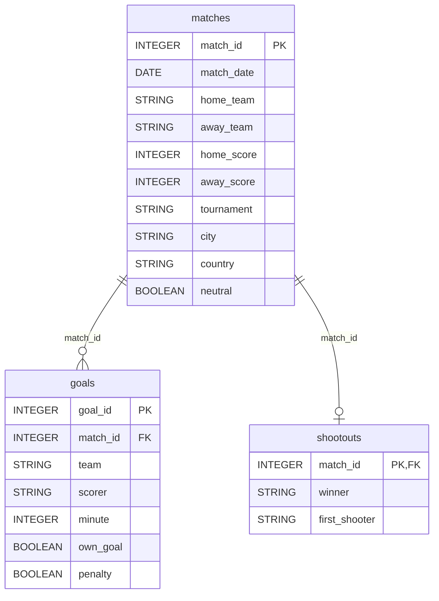

# International football results

Every men's full international football match from the first one, Scotland against England in November 1872, to 30 September 2026: 49,807 matches, the goal scorers for 15,540 of them, and 694 penalty shootouts. It includes Jordan's first FIFA World Cup (June 2026) and Jordan's run to the AFC Asian Cup final (played in January and February 2024).

Assignment 1 uses this dataset. You upload the three CSV files to BigQuery yourself.

## Files

| File | Table in BigQuery | One row is one … | Rows |
|---|---|---|---:|
| [`matches.csv`](matches.csv) | `football.matches` | match | 49,807 |
| [`goals.csv`](goals.csv) | `football.goals` | goal | 47,914 |
| [`shootouts.csv`](shootouts.csv) | `football.shootouts` | penalty shootout | 694 |

## Upload to BigQuery

1. Next to your project, **⋮** → **Create dataset**. **Dataset ID** `football`. **Location type** and region: the same as your `nakheel` dataset (the upload guide used **Multi-region US**). **Create dataset**.
2. Download the three CSV files from this folder.
3. For each file: next to `football`, **⋮** → **Create table**. **Create table from:** Upload; choose the file; **File format:** CSV. **Table:** `matches`, `goals` or `shootouts`. **Schema:** tick **Auto detect**. Under **Advanced options**, set **Header rows to skip** to 1. **Create table**.

The steps are the same as in [Upload a CSV to BigQuery](../../../modules/02-sql/resources/upload-a-csv-to-bigquery.md).

**Check the upload** before you write anything else:

| Table | Rows | Check |
|---|---:|---|
| `football.matches` | 49,807 | first `match_date` 1872-11-30, last 2026-09-30 |
| `football.goals` | 47,914 | `own_goal` and `penalty` show as BOOLEAN in the schema |
| `football.shootouts` | 694 | 430 rows have no `first_shooter` |

If `match_date` shows as STRING instead of DATE, or `neutral` as STRING instead of BOOLEAN, delete the table and upload it again with **Auto detect** ticked.

## Columns

### `matches`

| Column | Type | Meaning |
|---|---|---|
| `match_id` | INTEGER | **Primary key.** Added for this course: matches numbered in date order |
| `match_date` | DATE | Day the match was played |
| `home_team` | STRING | The team listed first. Not always playing at home: see `neutral` |
| `away_team` | STRING | The team listed second |
| `home_score` | INTEGER | Home team's goals at full time, including extra time, not counting a penalty shootout |
| `away_score` | INTEGER | Away team's goals, counted the same way |
| `tournament` | STRING | For example `Friendly`, `FIFA World Cup`, `FIFA World Cup qualification`, `AFC Asian Cup`, `Arab Cup` (225 different values) |
| `city` | STRING | City where it was played |
| `country` | STRING | Country where it was played, by its name at the time |
| `neutral` | BOOLEAN | `true` when neither team was playing at home |

### `goals`

| Column | Type | Meaning |
|---|---|---|
| `goal_id` | INTEGER | **Primary key.** Added for this course |
| `match_id` | INTEGER | **Foreign key** to `matches.match_id` |
| `team` | STRING | The team the goal counted for |
| `scorer` | STRING | Player who scored. 44 goals have no name |
| `minute` | INTEGER | Minute of the goal. 254 goals have no minute |
| `own_goal` | BOOLEAN | `true` when a player scored into his own net. `team` is then the team that benefited |
| `penalty` | BOOLEAN | `true` for a penalty kick during the match (not a shootout) |

### `shootouts`

| Column | Type | Meaning |
|---|---|---|
| `match_id` | INTEGER | **Primary key**, and **foreign key** to `matches.match_id`: a match has at most one shootout |
| `winner` | STRING | Team that won the shootout |
| `first_shooter` | STRING | Team that took the first kick. Empty for 430 shootouts |

## How the tables connect

`PK` is the primary key and `FK` a foreign key. One match has zero or more goals and zero or one shootout. Join `goals` or `shootouts` to `matches` on `match_id`.

## Things to know before you query

- **A team appears in two columns.** Jordan's matches are the rows where `home_team = 'Jordan'` **or** `away_team = 'Jordan'`, and Jordan's goals are `home_score` in some rows and `away_score` in others. Assignment 1 starts by building a view that puts every match from each team's side, so this is solved once.
- **`goals` does not cover every match.** It has scorers for 15,540 of the 49,807 matches, mostly recent ones and major tournaments. Every goal of the 2026 World Cup is there (308 goals in 104 matches), but most friendlies are not. The scores in `matches` are complete.
- **Team names are today's names**, so the history of a team that changed its name stays together. `country` keeps the name at the time of the match.
- **The AFC Asian Cup 2023 was played in 2024.** China withdrew as host, and Qatar held it from 12 January to 10 February 2024. Its `tournament` value is `AFC Asian Cup`, like every edition, so filter on the dates.
- **Two matches on 17 February 1974 have the same teams and date** (Tahiti against New Caledonia, played twice). They have different `match_id` values.

## Fixed checks

| Check | Value |
|---|---:|
| Matches | 49,807 |
| Goals in all match scores, `SUM(home_score + away_score)` | 146,377 |
| Rows in `goals` | 47,914 |
| Matches with at least one row in `goals` | 15,540 |
| Different teams | 337 |
| 2026 World Cup matches (11 June–19 July 2026) | 104 |
| 2026 World Cup goals, in scores and in `goals` | 308 |

## Source and licence

Mart Jürisoo, [International football results from 1872 to 2026](https://github.com/martj42/international_results) (also published on Kaggle), released under [CC0 1.0](https://creativecommons.org/publicdomain/zero/1.0/) (public domain). The data is gathered from Wikipedia, rsssf.com and football associations' websites; results are as recorded there.

Course copy taken on 9 October 2026 from the repository as of 7 October 2026 (commit `b7a3a8e`). Changes for the course: matches after 30 September 2026 removed; `match_id` and `goal_id` added; `date` renamed `match_date`; `goalscorers.csv` renamed `goals.csv` and linked to its match by `match_id` instead of date and team names; one shootout whose match is not in the results (Saare County against Åland Islands, 29 June 2011) removed; `former_names.csv` not included. The copy stays fixed so the numbers above do not change.
